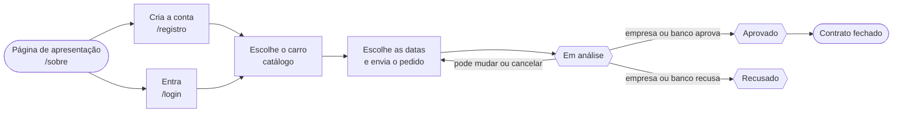
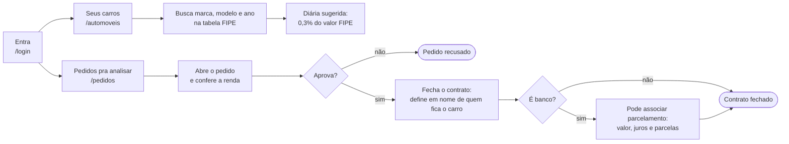
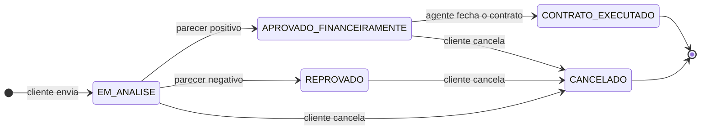

# 🚗 Aluga. · Aluguel de Carros 👨‍💻

Sistema web para gestão de aluguéis de automóveis: clientes fazem, modificam, consultam e cancelam pedidos pela Internet, e agentes (empresas e bancos) avaliam financeiramente os pedidos e executam os contratos.

> [!TIP]
> **Em uma frase:** o cliente escolhe o carro e manda o pedido; uma empresa ou um banco parceiro confere a renda, aprova e fecha o contrato. Tudo pelo navegador.

Projeto do **Laboratório 02** da disciplina **DIAW** (Desenvolvimento e Integração de Aplicações Web), Engenharia de Software, PUC Minas. Professor: João Paulo Carneiro Aramuni.

## 🚧 Status do Projeto


Protótipo funcional em desenvolvimento acadêmico.

## 📚 Índice

- [Links Úteis](#-links-úteis)
- [Sobre o Projeto](#-sobre-o-projeto)
- [Fluxos do Sistema](#-fluxos-do-sistema)
- [Interface](#-interface)
- [Funcionalidades Principais](#-funcionalidades-principais)
- [Tecnologias Utilizadas](#-tecnologias-utilizadas)
- [Arquitetura](#-arquitetura)
- [Instalação e Execução](#-instalação-e-execução)
- [Versão de demonstração](#-versão-de-demonstração-github-pages)
- [Deploy](#-deploy)
- [Estrutura de Pastas](#-estrutura-de-pastas)
- [Demonstração](#-demonstração)
- [Testes](#-testes)
- [Documentações utilizadas](#-documentações-utilizadas)
- [Autores](#-autores)
- [Agradecimentos](#-agradecimentos)

## 🔗 Links Úteis

- Modelagem UML (Mermaid, renderizada pelo GitHub): [`docs/modelagem`](docs/modelagem)
- API da Tabela FIPE: [deividfortuna.github.io/fipe](https://deividfortuna.github.io/fipe/)
- Esquema do banco de dados: [`docs/banco-de-dados.sql`](docs/banco-de-dados.sql)

## 📝 Sobre o Projeto

O objetivo é apoiar a gestão de aluguéis de automóveis, permitindo efetuar, cancelar e modificar pedidos pela Internet. Os pedidos, depois de introduzidos, passam por análise financeira dos agentes e, com parecer positivo, seguem para a execução do contrato.

Sobre os contratantes, o sistema guarda RG, CPF, nome, endereço, profissão e as entidades empregadoras com os respectivos rendimentos (no máximo 3). Dependendo do tipo de contrato, o automóvel é registrado como propriedade do cliente, de uma empresa ou de um banco, e o aluguel pode estar associado a um contrato de crédito concedido por um banco agente. O contexto é acadêmico.

O sistema só pode ser usado após **cadastro prévio e login** (usuário e senha).

## 🔀 Fluxos do Sistema

Tem mais desenhos (mapa de telas, sequências entre site e API, arquitetura) em [`docs/fluxos`](docs/fluxos/README.md).

São **dois caminhos**: o de quem aluga (cliente) e o de quem aprova (empresa ou banco). O banco segue o mesmo caminho da empresa, com um passo a mais: pode oferecer parcelamento (contrato de crédito).

### 🙋 Jornada do cliente



### 🏢 Fluxo do parceiro (empresa ou banco)



### 🚦 Situações do pedido



| Status no back-end | Como aparece na tela | Quem pode mexer |
|---|---|---|
| `EM_ANALISE` | Em análise | cliente muda ou cancela; agente aprova ou recusa |
| `APROVADO_FINANCEIRAMENTE` | Aprovado | agente fecha o contrato; cliente pode cancelar |
| `REPROVADO` | Recusado | cliente pode cancelar |
| `CONTRATO_EXECUTADO` | Contrato fechado | ninguém (final) |
| `CANCELADO` | Cancelado | ninguém (final) |

## 🎨 Interface

Visual escuro com cartões de vidro, inspirado num layout de referência do Figma Community. A ideia é que **a cor fique nas fotos dos carros**: a interface é neutra e usa uma única cor de destaque (verde-oliva) só no que pede atenção, como o status *Em análise*.

| Elemento | Escolha |
|---|---|
| Fundo | verde bem escuro `#1E241B` |
| Destaque | verde-oliva `#8FA36A` (único) |
| Superfícies | vidro: degradê branco translúcido, borda fina e sombra |
| Tipografia | [Inter](https://fonts.google.com/specimen/Inter) |
| Ícones | [coolicons](https://coolicons.cool) no estilo duocolor (licença MIT): traço branco e parte secundária em verde-oliva, em `components/Icone.tsx` |
| Fotos | recortes sem fundo em `frontend/public/carros`, com cores neutralizadas |
| Rodapé | painel de vidro com links do perfil logado, "voltar ao topo" e marca d'água |
| Textos | linguagem simples, sem jargão ("Contrato fechado" em vez de "Contrato executado") |

### Telas

| Rota | Tela | Quem vê |
|---|---|---|
| `/sobre` | Página de apresentação (o que é, para quem, como funciona, preços, dúvidas) | todos |
| `/login` | Entrar, com contas de exemplo | todos |
| `/registro` | Criar conta de cliente | todos |
| `/` | Catálogo de carros | cliente |
| `/pedidos/novo` | Novo pedido | cliente |
| `/pedidos` | Meus pedidos / Pedidos pra analisar | cliente e agente |
| `/pedidos/:id` | Detalhe do pedido: resposta, fechamento do contrato e, pro cliente, mudar ou cancelar (com confirmação) | cliente e agente |
| `/meus-dados` | Dados pessoais e renda, e excluir a conta (com confirmação) | cliente |
| `/automoveis` | Seus carros, com busca na tabela FIPE | agente |
| `/clientes` | Lista de clientes, com parte do CPF escondida | agente |

> [!NOTE]
> Quem não está logado e tenta abrir uma tela protegida é levado para a página de apresentação (`/sobre`).

## ✨ Funcionalidades Principais

- **Página de apresentação**: explica o sistema para quem ainda não tem conta, com comparação de diárias e perguntas frequentes.
- **Autenticação**: cadastro de clientes, login obrigatório com usuário e senha, sessão HTTP e logout.
- **CRUD de cliente**: cadastro, consulta, atualização e exclusão dos próprios dados, incluindo até 3 empregadores com rendimento.
- **Pedidos de aluguel (cliente)**: introduzir, modificar (enquanto em análise), consultar o status e cancelar.
- **Análise e contratos (agentes)**: avaliar pedidos com parecer financeiro, modificar pedidos, executar o contrato definindo o proprietário do automóvel e, para bancos, associar contrato de crédito.
- **Catálogo de automóveis**: tela inicial do cliente, com matrícula, ano, marca, modelo, placa (padrão Mercosul) e diária; gerido pelos agentes.
- **Integração com a Tabela FIPE**: no cadastro de automóvel, o agente escolhe marca, modelo e ano pela [API pública da FIPE](https://deividfortuna.github.io/fipe/) e o sistema preenche os campos e sugere a diária (0,3% do valor de tabela).
- **Contas de exemplo**: com o seed habilitado, a tela de login oferece entrada com um clique como cliente, empresa ou banco.
- **Perfis e autorização**: cliente, agente (empresa) e agente (banco), com regras de acesso aplicadas no back-end.

## 🛠 Tecnologias Utilizadas

### 💻 Front-end
- React 19 + Vite 8 (TypeScript)
- React Router 7
- CSS puro, organizado em `src/styles` (separado dos componentes); tipografia Inter (Google Fonts)
- API pública da Tabela FIPE (marcas, modelos, anos e valores)

### 🖥️ Back-end
- Java (JDK 25)
- Spring Boot 4.0.x (Spring Web MVC, Spring Data JPA, Spring Security, Bean Validation)
- Apache Maven
- Banco de dados: Supabase (PostgreSQL), acesso via JPA/Hibernate
- Autenticação: usuário e senha (BCrypt) com sessão HTTP

## 🏗 Arquitetura

Back-end em **MVC** com camadas bem separadas, e front-end como SPA que consome a API REST.

- **Model**: entidades JPA e enums (`model`).
- **View**: telas React em TypeScript (`frontend/src/pages`), montadas dinamicamente a partir dos dados da API. Os tipos em `frontend/src/types.ts` espelham os DTOs do back-end.
- **Controller**: endpoints REST (`controller`), que validam a entrada e delegam aos serviços.
- **Service / Repository**: regras de negócio (`service`) e acesso a dados (`repository`).
- **Segurança**: todas as rotas exigem autenticação, exceto login e cadastro. O cookie de sessão é HttpOnly e SameSite=Lax.

Principais decisões:

- Entidades nunca são expostas diretamente: a API usa DTOs.
- As regras de transição de status e de dono do pedido ficam no serviço, não na tela.
- Em desenvolvimento, o Vite encaminha `/api` ao Spring (proxy), mantendo a mesma origem e dispensando CORS.
- CSRF está desativado por simplicidade acadêmica (API com sessão e SameSite=Lax); em produção seria preciso reavaliar.

Diagramas (UML em Mermaid):

| Diagrama | Arquivo |
|---|---|
| Casos de uso | [`docs/modelagem/01-casos-de-uso.md`](docs/modelagem/01-casos-de-uso.md) |
| Histórias do usuário | [`docs/modelagem/02-historias-do-usuario.md`](docs/modelagem/02-historias-do-usuario.md) |
| Classes e estados do pedido | [`docs/modelagem/03-diagrama-de-classes.md`](docs/modelagem/03-diagrama-de-classes.md) |
| Pacotes (visão lógica) | [`docs/modelagem/04-diagrama-de-pacotes.md`](docs/modelagem/04-diagrama-de-pacotes.md) |

### Endpoints da API

| Método | Rota | Quem acessa |
|---|---|---|
| POST | `/api/auth/registro` | público (cadastro de cliente) |
| POST | `/api/auth/login` | público |
| GET | `/api/auth/me` | autenticado |
| POST | `/api/auth/logout` | autenticado |
| GET, PUT, DELETE | `/api/clientes/me` | cliente |
| GET | `/api/clientes`, `/api/clientes/{id}` | agente |
| GET | `/api/automoveis` | autenticado |
| POST, PUT, DELETE | `/api/automoveis`, `/api/automoveis/{id}` | agente |
| POST | `/api/pedidos` | cliente |
| GET | `/api/pedidos`, `/api/pedidos/{id}` | cliente (os seus) ou agente (todos) |
| PUT | `/api/pedidos/{id}` | cliente (em análise) ou agente |
| POST | `/api/pedidos/{id}/cancelar` | cliente |
| POST | `/api/pedidos/{id}/avaliar` | agente |
| POST | `/api/pedidos/{id}/executar` | agente (crédito apenas banco) |

## 🔧 Instalação e Execução

### Pré-requisitos

- JDK 25
- Maven 3.9+
- Node.js 20+ e npm
- Um projeto no [Supabase](https://supabase.com) (banco PostgreSQL)

### 🔑 Variáveis de Ambiente

#### 1. Back-end (Spring Boot)

| Variável | Descrição | Exemplo |
|---|---|---|
| `DB_URL` | URL JDBC do Supabase | `jdbc:postgresql://db.SEU_PROJETO.supabase.co:5432/postgres?sslmode=require` |
| `DB_USER` | Usuário do banco | `postgres` |
| `DB_PASSWORD` | Senha do banco | definida no Supabase |
| `PORT` | Porta do servidor (opcional) | `8080` |
| `SEED_ENABLED` | Cria contas e carros de exemplo (opcional) | `true` |
| `SEED_AGENT_PASSWORD` | Senha das contas de exemplo (`agente.empresa`, `agente.banco` e `cliente.demo`) | escolha uma senha |

Há um modelo em [`backend/.env.example`](backend/.env.example). O Spring não lê `.env` sozinho: exporte as variáveis no terminal. **Nunca faça commit de senhas.**

#### 2. Front-end (React, Vite)

| Variável | Descrição | Exemplo |
|---|---|---|
| `VITE_API_PROXY_TARGET` | Back-end para o proxy do Vite (opcional) | `http://localhost:8080` |
| `VITE_DEMO_PASSWORD` | Mostra os botões de contas de exemplo no login (opcional, só demonstração); use o mesmo valor de `SEED_AGENT_PASSWORD`. Coloque em `frontend/.env.local` | `uma-senha-de-dev` |

### 📦 Instalação de Dependências

```bash
git clone https://github.com/christiano-gonara/AluguelCarro.git
cd AluguelCarro

# Front-end
cd frontend && npm install && cd ..

# Back-end (baixa as dependências ao compilar)
cd backend && mvn clean package -DskipTests && cd ..
```

### 💾 Inicialização do Banco de Dados (Supabase)

1. No Supabase, copie os dados de conexão do banco em *Project Settings > Database*.
2. Defina `DB_URL`, `DB_USER` e `DB_PASSWORD`.
3. As tabelas são criadas automaticamente pelo Hibernate na primeira execução (`ddl-auto=update`). Para criá-las manualmente, use [`docs/banco-de-dados.sql`](docs/banco-de-dados.sql) no SQL Editor.

### ⚡ Como Executar a Aplicação

**Terminal 1: Back-end (porta 8080)**

```bash
cd backend
export DB_URL='jdbc:postgresql://db.SEU_PROJETO.supabase.co:5432/postgres?sslmode=require'
export DB_USER=postgres
export DB_PASSWORD='sua-senha'
# opcional: agentes e carros de exemplo
export SEED_ENABLED=true
export SEED_AGENT_PASSWORD='uma-senha-de-desenvolvimento'
mvn spring-boot:run
```

**Terminal 2: Front-end (porta 5174)**

```bash
cd frontend
npm run dev
```

Acesse `http://localhost:5174`. Com o seed habilitado, as contas `agente.empresa`, `agente.banco` e `cliente.demo` usam a senha definida em `SEED_AGENT_PASSWORD`. Outros clientes se cadastram pela própria tela.

Em desenvolvimento, o Vite encaminha `/api` ao Spring Boot e `/fipe` à API da Tabela FIPE (veja `frontend/vite.config.ts`).

## 🌐 Versão de demonstração (GitHub Pages)

Dá pra ver o visual funcionando sem instalar nada: **https://christiano-gonara.github.io/AluguelCarro/**

- Roda **sem o back-end**: os dados de exemplo ficam só no navegador de quem acessa (`frontend/src/demo`), seguindo as mesmas regras e mensagens da API.
- Contas de exemplo (senha `demo`): `cliente.demo`, `marina.souza`, `lucas.pereira`, `agente.empresa` e `agente.banco`. A aba **Cenários desta tela**, no topo, mostra o que testar naquela tela (só do seu perfil), e o bloco **Cenários de uso**, no fim, troca de conta com um clique. O botão **Recomeçar** volta os dados ao começo.
- Publicada sozinha a cada push na `main` pelo GitHub Actions ([`.github/workflows/pages.yml`](.github/workflows/pages.yml)).
- Os cenários pra testar cada fluxo estão em [`docs/fluxos/07-cenarios.md`](docs/fluxos/07-cenarios.md).

Pra abrir a demonstração no seu computador (não precisa do back-end):

```bash
cd frontend
npm install
npm run demo        # abre em http://localhost:5174
```

## 🚀 Deploy

```bash
# Front-end: gera frontend/dist
cd frontend && npm run build

# Back-end: gera backend/target/aluguel-carro-1.0.0.jar
cd backend && mvn clean package
java -jar target/aluguel-carro-1.0.0.jar
```

Configure as variáveis de ambiente de produção no servidor. Como o front-end em produção ficará em outra origem, será preciso servir `dist` atrás do mesmo domínio da API (proxy reverso) ou habilitar CORS com credenciais no back-end.

## 📂 Estrutura de Pastas

```text
AluguelCarro/
├── backend/                      # Spring Boot (Maven)
│   ├── pom.xml
│   └── src/
│       ├── main/java/br/com/aluguelcarro/
│       │   ├── config/           # DataSeeder
│       │   ├── controller/       # Endpoints REST
│       │   ├── dto/              # Entrada e saída da API
│       │   ├── exception/        # Erros de negócio e tratamento
│       │   ├── model/            # Entidades e enums
│       │   ├── repository/       # Spring Data JPA
│       │   ├── security/         # Login, sessão e papéis
│       │   └── service/          # Regras de negócio
│       ├── main/resources/application.properties
│       └── test/                 # Testes
├── frontend/                     # React + Vite + TypeScript
│   ├── public/carros/            # Fotos recortadas dos carros (sem fundo)
│   ├── tsconfig.json
│   ├── vite.config.ts
│   └── src/
│       ├── auth/                 # Contexto de autenticação
│       ├── demo/                 # "Servidor" e dados da versão de demonstração (GitHub Pages)
│       ├── components/           # Layout, formulários e peças comuns
│       ├── pages/                # Telas
│       ├── styles/               # CSS separado dos componentes, um arquivo por bloco (animacoes.css junta as animações)
│       ├── utils/                # Formatadores e cliente da Tabela FIPE
│       ├── api.ts                # Cliente HTTP tipado
│       └── types.ts              # Tipos que espelham os DTOs da API
└── docs/
    ├── fluxos/                   # Fluxogramas, mapa de telas, sequências e arquitetura (Mermaid)
    ├── modelagem/                # Casos de uso, histórias, classes e pacotes
    └── banco-de-dados.sql
```

## 🎥 Demonstração

### 💻 Exemplo de Saída no Terminal (API com cURL)

```bash
# Login (guarda o cookie de sessão)
curl -i -c cookies.txt -H 'Content-Type: application/json' \
  -d '{"username":"agente.empresa","senha":"SUA_SENHA"}' \
  http://localhost:8080/api/auth/login
```

```json
{ "username": "agente.empresa", "perfil": "AGENTE_EMPRESA", "clienteId": null }
```

```bash
# Listar pedidos usando a sessão
curl -b cookies.txt http://localhost:8080/api/pedidos
```

## 🧪 Testes

```bash
cd backend
mvn test
```

Os testes atuais cobrem regras do modelo (valor estimado do pedido, limite de 3 empregadores e soma de rendimentos).

## 🔗 Documentações utilizadas

- [Spring Boot](https://spring.io/projects/spring-boot)
- [Spring Security](https://spring.io/projects/spring-security)
- [Supabase](https://supabase.com/docs)
- [React](https://react.dev)
- [Vite](https://vite.dev)
- [Mermaid](https://mermaid.js.org)

## 👥 Autores

| Nome | GitHub |
|---|---|
| Christiano Gonçalves Araujo | [@christiano-gonara](https://github.com/christiano-gonara) |

## 📸 Créditos das fotos

As fotos dos carros vêm do [Wikimedia Commons](https://commons.wikimedia.org), com fundo removido, cores neutralizadas e algumas espelhadas:

| Carro | Autor | Licença |
|---|---|---|
| Toyota Corolla | Dinkun Chen | CC BY-SA 4.0 |
| Fiat Argo | JasonVogel | CC BY-SA 4.0 |
| Chevrolet Onix | Just a Man | CC BY 4.0 |
| Hyundai HB20 | Just a Man | CC BY 4.0 |
| Volkswagen T-Cross | M 93 | CC BY-SA 3.0 DE |
| Jeep Compass | Kevauto | CC BY-SA 4.0 |

Carros fora dessa lista usam a foto do artigo da Wikipédia, buscada na hora pelo navegador.

Os ícones são do [coolicons](https://coolicons.cool), de Kryston Schwarze, sob licença MIT.

## 🙏 Agradecimentos

À PUC Minas e ao professor João Paulo Carneiro Aramuni, pela proposta e pelo material da disciplina DIAW.
