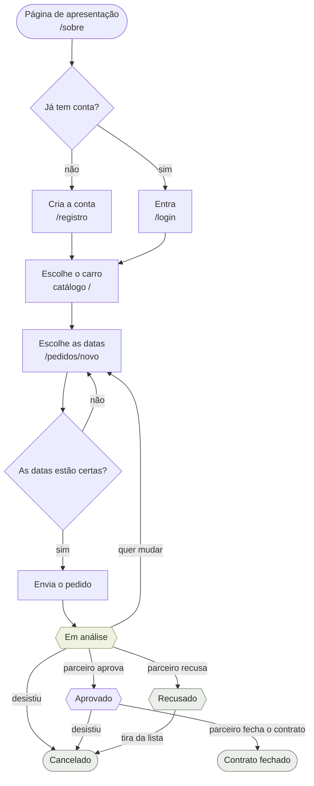
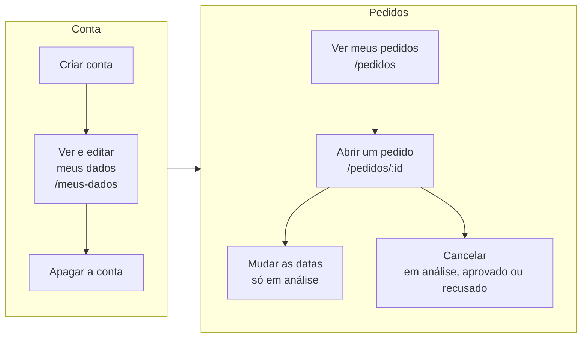

# Jornada do cliente

Quem aluga entra pela página de apresentação, cria a conta (ou entra), escolhe um carro e manda o pedido. Daí em diante, só acompanha: quem decide é a empresa ou o banco dono do carro.

## O que o cliente pode fazer em cada momento

