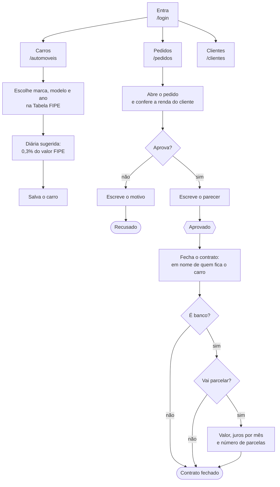

# Fluxo do parceiro (empresa ou banco)

Empresa e banco seguem o mesmo caminho. A única diferença é que o banco, ao fechar o contrato, pode oferecer um parcelamento (contrato de crédito).

## Regras que a API confere

| Ação | Só funciona se… |
|---|---|
| Aprovar ou recusar | o pedido estiver **em análise** |
| Fechar o contrato | o pedido estiver **aprovado** |
| Oferecer parcelamento | quem fecha for um **banco** |
| Qualquer ação de parceiro | quem está logado for **agente** (empresa ou banco) |
