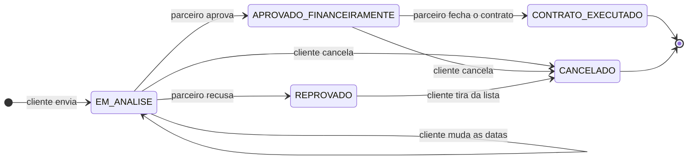

# Situações do pedido

Todo pedido começa **em análise**. Ele termina em uma de duas situações finais: **contrato fechado** ou **cancelado**.

| No back-end | Na tela | Quem pode mexer |
|---|---|---|
| `EM_ANALISE` | Em análise | cliente muda ou cancela; parceiro aprova ou recusa |
| `APROVADO_FINANCEIRAMENTE` | Aprovado | parceiro fecha o contrato; cliente pode cancelar |
| `REPROVADO` | Recusado | cliente pode cancelar |
| `CONTRATO_EXECUTADO` | Contrato fechado | ninguém (final) |
| `CANCELADO` | Cancelado | ninguém (final) |
