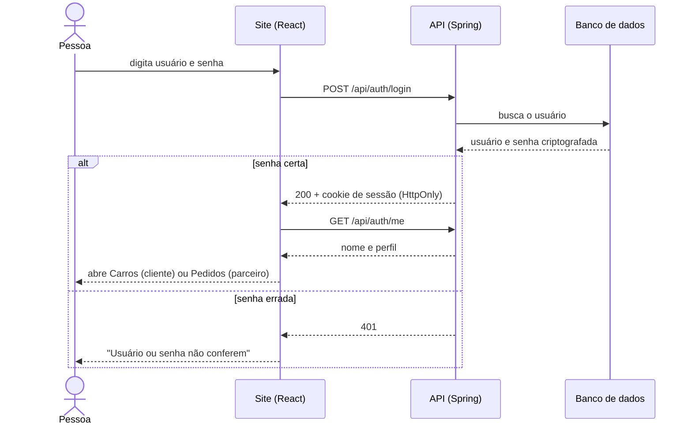
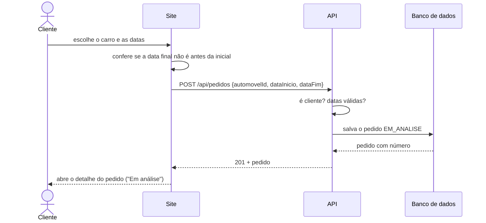
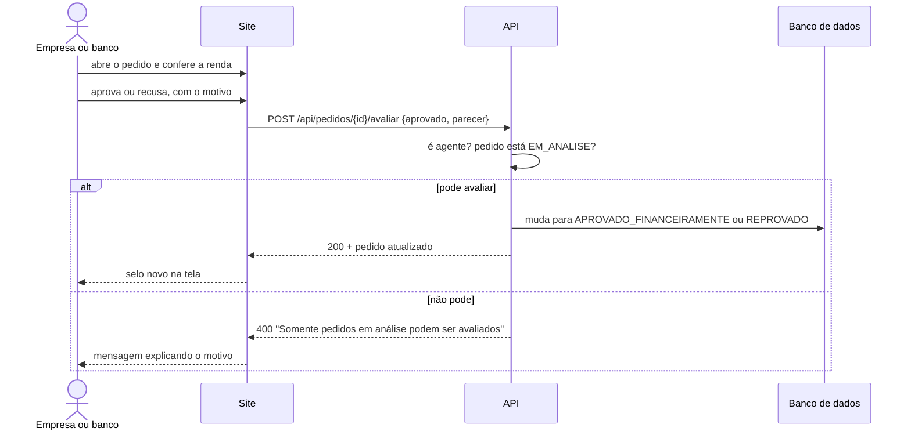
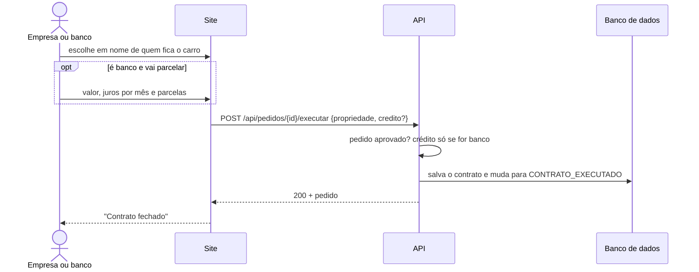
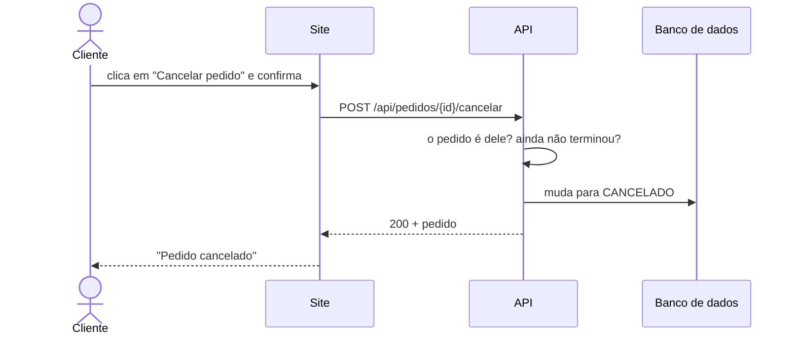

# Sequências

O que acontece por trás de cada ação: o navegador (site), a API (Spring Boot) e o banco de dados (PostgreSQL no Supabase).

## Entrar

## Cliente faz um pedido

## Parceiro aprova ou recusa

## Parceiro fecha o contrato

## Cliente cancela

