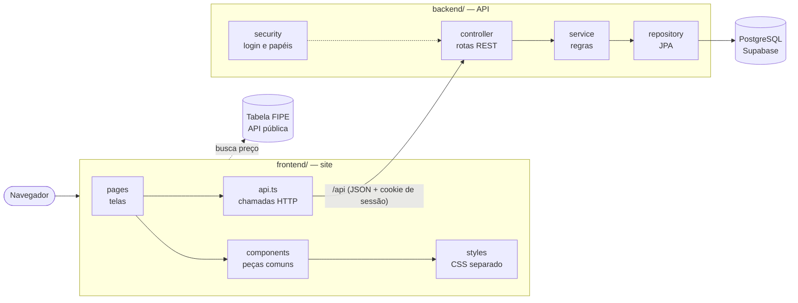
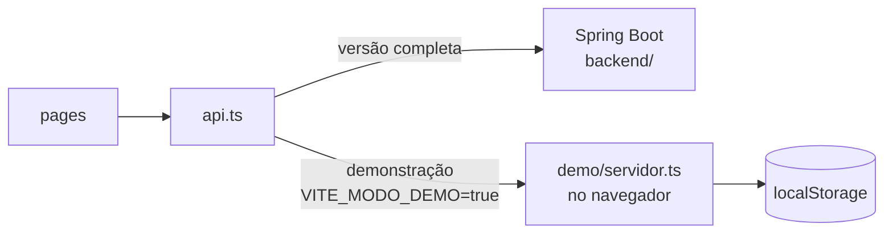

# Arquitetura: site e API separados

O projeto tem duas partes, cada uma na sua pasta:

| Pasta | O que é | Tecnologia |
|---|---|---|
| `frontend/` | O **site** (a parte web que a pessoa vê) | React + TypeScript + Vite |
| `backend/` | A **API** (regras de negócio e acesso ao banco) | Java 25 + Spring Boot |
| `docs/` | Documentação: diagramas, fluxos e script do banco | Markdown + Mermaid + SQL |

O site nunca fala direto com o banco de dados: ele sempre pede à API.

## Versão de demonstração (GitHub Pages)

O GitHub Pages só hospeda arquivos estáticos, então lá o site roda **sem a API**. Quando o build é feito com `VITE_MODO_DEMO=true`, as chamadas que iriam pro Spring Boot são atendidas por `frontend/src/demo/servidor.ts`, que roda no navegador, segue as mesmas regras e mensagens da API e guarda os dados no `localStorage`.

## Como o CSS está dividido

Os estilos ficam em `frontend/src/styles/`, separados dos componentes, um arquivo por bloco da interface:

| Arquivo | Cuida de |
|---|---|
| `base.css` | cores, fontes e medidas (variáveis) |
| `layout.css` | topo, vidro, rodapé |
| `forms.css` | campos e botões |
| `tables.css` | tabelas de vidro, busca e paginação |
| `components.css` | selos de situação, avisos, telas vazias e de erro |
| `catalogo.css` | cartões de carro |
| `login.css` | tela de entrar |
| `landing.css` | página de apresentação |
| `avisos.css` | notificações do sistema, aviso da demo/Sistema e página 404 |
| `animacoes.css` | tudo o que se mexe ao passar o mouse |
| `index.css` | junta todos na ordem certa |
