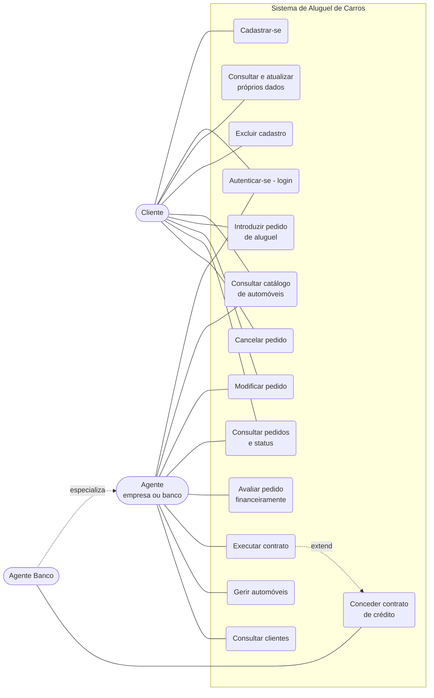

# Diagrama de Casos de Uso

Atores: **Cliente** (usuário individual) e **Agente** (empresa ou banco). O **Agente Banco** é uma especialização que, além de tudo que o agente faz, concede contratos de crédito.

## Descrição resumida

| Caso de uso | Ator | Regra principal |
|---|---|---|
| Cadastrar-se | Cliente | Cadastro prévio obrigatório: usuário, senha, RG, CPF, nome, endereço, profissão e até 3 empregadores com rendimento. |
| Autenticar-se | Cliente, Agente | O sistema só é usado após login com usuário e senha. |
| Introduzir pedido | Cliente | Escolhe automóvel e período; o pedido nasce **Em análise**. |
| Modificar pedido | Cliente, Agente | Cliente: só enquanto em análise. Agente: enquanto o pedido não estiver cancelado ou executado. |
| Cancelar pedido | Cliente | Apenas os próprios pedidos, antes da execução do contrato. |
| Avaliar pedido | Agente | Parecer financeiro positivo (Aprovado) ou negativo (Reprovado). |
| Executar contrato | Agente | Só após parecer positivo; define em nome de quem o automóvel é registrado (cliente, empresa ou banco). |
| Conceder contrato de crédito | Agente Banco | Opcional, associado à execução do contrato. |
| Gerir automóveis | Agente | Cadastrar, alterar e remover automóveis (matrícula, ano, marca, modelo, placa). |
