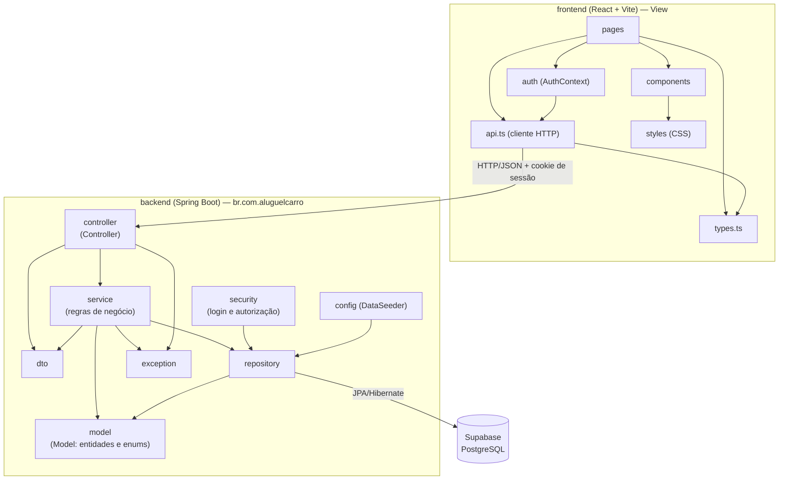

# Diagrama de Pacotes (Visão Lógica)

Arquitetura **MVC** em camadas. A **View** é a SPA React, que consome a API REST; no back-end, os controllers recebem as requisições, os services concentram as regras e os repositories acessam o banco (Supabase/PostgreSQL).

## Responsabilidades

| Pacote | Responsabilidade |
|---|---|
| `model` | Entidades JPA (`Usuario`, `Cliente`, `Empregador`, `Automovel`, `PedidoAluguel`, `ContratoCredito`) e enums. |
| `repository` | Interfaces Spring Data JPA; único ponto de acesso ao banco. |
| `service` | Regras: transições de status, autorização por dono do pedido, limite de 3 empregadores, crédito só para banco. |
| `controller` | Endpoints REST, validação de entrada e delegação ao service. |
| `dto` | Contratos de entrada e saída da API (nenhuma entidade é exposta). |
| `security` | Spring Security: login por usuário e senha (BCrypt), sessão HTTP e papéis. |
| `exception` | Exceções de negócio e tradução para respostas HTTP. |

## Subsistemas citados no enunciado

1. **Gestão de pedidos e contratos**: `service`/`controller` de pedidos, clientes e automóveis.
2. **Construção dinâmica das páginas web**: front-end React, que monta as telas a partir dos dados da API.
